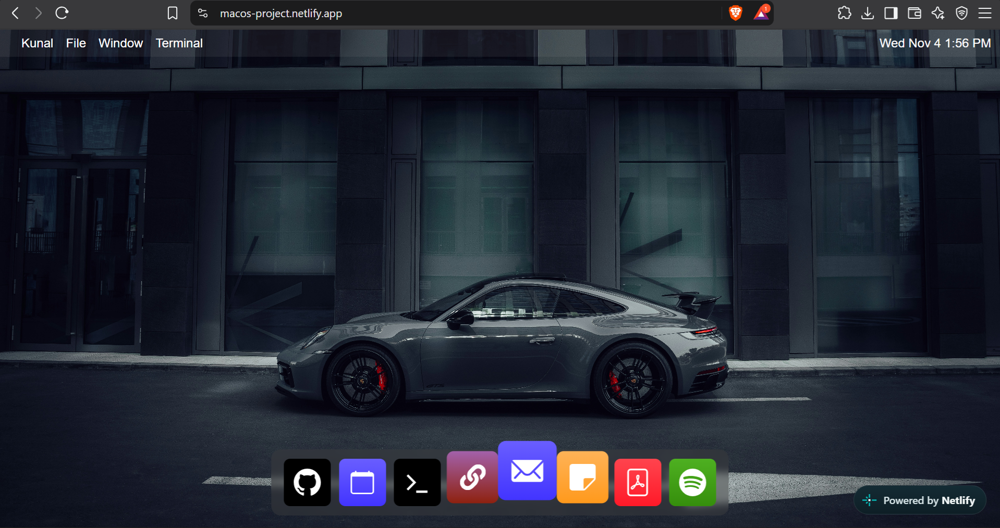

macOS-Style Portfolio
A portfolio website designed like a macOS desktop, built with React.js and SCSS.
🔗 Live demo: https://macos-project.netlify.app/
<!-- Add a screenshot: save it as screenshot.png in this repo, then uncomment the next line -->
<!--  -->
Features
Desktop-style app icons that open interactive windows:
Spotify - music
Notes / PDF viewer - view documents
GitHub - link to my GitHub profile
Calendar
Mail
Terminal
LinkedIn link to my profile
Tech stack
React.js
SCSS
Deployed on Netlify
Run locally
```bash
git clone <this-repo-url>
cd <repo-folder>
npm install
npm run dev     # or: npm start (use the command from your package.json scripts)
```
Testing
Manually tested every app icon for the expected click and navigation behaviour
Exploratory and UI testing to find layout and functional issues, then verified the fixes
Checked responsiveness and visual consistency across screen sizes and browsers
Verified all outbound links
Author
Kunal Kundnani - LinkedIn | GitHub
